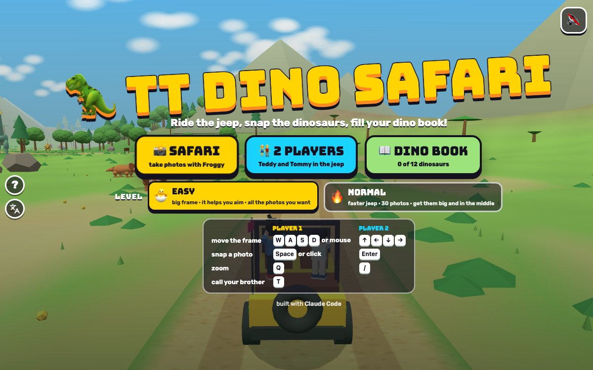

# TT Dino Safari

Press **?** any time (or tap the round **?** button on the left edge) to see the keys. The game waits while you look.
Tap the language button under it (the A文 icon) to switch between English and 中文; the dashboard and every game remember the choice.

**中文：** 恐龙探险：坐上吉普车穿过恐龙山谷，用相机给 12 种恐龙拍照（只拍照，不打猎），拍得越大、越正、越清楚，星星越多；每张新照片都会放进你的恐龙图鉴，还附带一个恐龙小知识。

A photo safari through a dinosaur valley for Teddy and Tommy. Foxy 🦊 drives the jeep along a dirt road past grassy plains, tall trees, a blue lake, rocky hills, a smoking volcano and big rocks, and you stand in the back with a camera. Move the frame onto a dinosaur and snap: big, in the middle and facing you is 3 stars, and catching its special move (the ✨) is a bonus. Every dinosaur you photograph goes into your **dino book** with your best photo and a fact. Froggy 🐸 takes photos too, or the brothers ride together and see who gets the better pictures. Nobody hunts anything.

It's built with Claude Code from plain JavaScript and Three.js, in the same style as Metro Surfer and the other Teddy & Tommy games. There are no image, model or audio files: the valley, the trees and the twelve dinosaurs are balls, tubes and boxes, Teddy and Tommy come from the shared kit (`kit/`), and every sound is synthesised.

## Play

- **Double-click `index.html`.** It works offline, because Three.js and the kit are copied into `kit/`. Without internet the logo falls back from the Bungee font to Arial Black.
- **Send one file:** `dist/dino-safari-tt.html` is the whole game in one file. AirDrop or email it, then open it in a browser.
- **Rebuild that file** after any edit: `python3 kit/tools/bundle.py . --name dino-safari-tt`
- **Get kit updates** from `~/claude-games/kit`: `python3 ../kit/tools/sync.py .`, then rebuild.
- **On the title** pick 📸 SAFARI, 👫 2 PLAYERS or 📖 DINO BOOK, and 🐣 EASY or 🔥 NORMAL; then who takes the photos (2 players: who is player 1, and each brother's own level). Behind the title the jeep drives through the valley.
- **A ride** goes from the start camp to the finish camp, about two and a half minutes on EASY and two on NORMAL. The jeep slows down when there's a dinosaur close by that you haven't photographed yet. A sign and a banner tell you which part of the valley you're in.
- **The end:** the winner climbs onto the jeep's bonnet and does his move facing you (Teddy's boxing, then his 🏀 jump shot; Tommy's Y with peace fingers ✌️; Froggy hops) while confetti flies, then the results: everyone's points, dinosaurs and stars, this ride's best photo of each dinosaur, how many are new in the dino book, and (in Safari) the best score, with 🏆 NEW BEST when you beat it. ↻ PLAY AGAIN, 📖 DINO BOOK or MENU.
- **Saved per browser:** the level, who takes photos, each brother's 2-player level, the dino book (the best photo of each dinosaur, who took it and its stars), the best score on each level and the wins. `index.html` and `dist/dino-safari-tt.html` each keep their own, because they're different ways of opening the game.

### The dinosaurs

Twelve to find, in the order the road meets them. The Pteranodon isn't a dinosaur (its fact says so).

| | Where | Special move | Fact for the book |
|---|---|---|---|
| Compsognathus | hiding in tall grass on the plains; peeks out when the jeep comes near | PEEKABOO! | about as big as a chicken |
| Triceratops | grazing on the plains, a grown-up and a young one | MUNCH! | its name means "three-horned face" |
| Velociraptor | a pack of three playing chase in a circle | LEAP! | had feathers, about as big as a turkey |
| Brachiosaurus | in the tall trees, eating from a big tree | TREETOP SNACK! | as tall as a 4-storey building |
| Stegosaurus | walking between the trees | TAIL SWING! | plates on its back, four spikes on its tail |
| Pachycephalosaurus | two of them bumping heads in a clearing | BONK! | a thick, hard dome on its head |
| Spinosaurus | fishing in the blue lake | SPLASH! (and a 🐟) | a big sail on its back, loved fish |
| Parasaurolophus | two at the little pond | HONK! (🎶) | honked through the long crest on its head |
| Ankylosaurus | stomping round the rocky hills | CLUB SWING! | armour like a tank, a club on its tail |
| Maiasaura | with three babies in a nest | BABY HELLO! | its name means "good mother lizard" |
| Pteranodon | two flying circles near the volcano | SWOOP! | a flying reptile, wings wider than a car is long |
| T. rex | waiting by the big rocks at the end of the road | ROAR! | teeth as long as bananas |

When a dinosaur starts its special move a ✨ sparkles over it: snap then for a bonus. A new dinosaur's fact shows on the screen and is read aloud (when the sound is on), and every page you've found in the dino book has a 🔈 button that reads it again, in English or 中文.

### Photos and stars

- **What's in the photo** is what's inside your frame (the jeep is left out). The photo is of the dinosaur nearest the middle of the frame.
- **Points** (up to 100): how big it is in the frame matters most (a tiny dinosaur far away is a 1-star photo however nicely framed), then how much of it is inside the frame, how near the middle it is, and whether it faces you (its tail end scores less). Its special move adds 15, and a second one of the same kind in the photo adds 5.
- **No photo:** nothing in the frame (NO DINO! 🙈), too small (TOO FAR! zoom in with 🔍), mostly outside the frame (ALMOST!), hidden by a tree or a rock (A TREE IS IN THE WAY!) or still in the grass (IT'S HIDING!).
- **Zoom** (🔍, Q or /) makes the frame half the size, so a far-away dinosaur fills more of it.
- **Your score** for a ride is your best photo of each dinosaur added up, so the way to win is to find more of them and take better photos, not to press the button more.

### Levels

- **🐣 EASY (Tommy, 5):** a big frame that drifts onto the nearest dinosaur when you stop moving it, counts a dinosaur a little outside the frame, as many photos as you like, a slower jeep, and stars come easily (any dinosaur in the photo is at least 1 star). Froggy is still learning, so a 5-year-old pressing the button whenever he sees a dinosaur beats him (the check plays 12 rides to make sure).
- **🔥 NORMAL (Teddy, 8):** a smaller frame that stays where you put it, 30 photos of film, a faster jeep, and 3 stars need a big, centred photo. Froggy takes good photos.

### Safari, 2 players and the dino book

- **📸 Safari:** you and Froggy in the back of the jeep. Froggy's green frame flashes when he takes a photo, and his score is top right.
- **👫 2 players:** Teddy and Tommy both in the back, each with his own frame (yellow for player 1, blue for player 2), his own keys and his own level. Both fill the same dino book.
- **📖 Dino book:** all twelve pages. A dinosaur you haven't found yet is a dark shape with a hint where to look.

## Controls

| | Player 1 | Player 2 |
|---|---|---|
| move the frame | W A S D or mouse | ↑ ← ↓ → |
| snap a photo | Space or click | Enter |
| zoom in · out | Q | / |
| call your brother (2 players: high five) | T | T |
| pause · sound | P or Esc · M | |
| title: safari · 2 players · dino book · easy | 1 2 B E | |

In 1 player both sets of keys work. On a touch screen, tap a dinosaur to take its photo, or slide your finger to move the frame and let go to snap; 🔍 zooms; your brother's face calls him. In 2 players the left half of the screen is player 1's and the right half player 2's.

## Companion

- **Call your brother** with T (or his face button) any time in a ride, as often as you like. Tommy calls Teddy and Teddy calls Tommy.
- He pops in at the back of the jeep (at his buddy size), facing you, does his move (Tommy: the Y with peace fingers; Teddy: boxing, then a jump shot with a 🏀), tosses you a treat (🍦 💧 🧃 🍪 🍉 🍌, "🍪 YUM!"), then **points the camera**: "TOMMY SAYS: SNAP IT NOW!" (or TEDDY SAYS) and your frame glides onto the best dinosaur you haven't got 3 stars of and stays on it for six seconds, so you only have to press the button. If none is in sight he aims where the next one will come ("ONE IS COMING!"). Then he waves and pops off. Call him again as soon as he's tossed his treat.
- **2 players:** T is a high five ✋: the brothers turn and slap hands in the jeep, with confetti.

## How it was checked

- **`node tools/check.js`** (about 14 seconds), the same check as `game.check()` in the page ([js/sim.js](js/sim.js)):
  - **every dino findable:** the whole valley ridden on both levels and three screen shapes (1200x750, a phone sideways 740x360, a phone upright 390x844), with the jeep never slowing down. At every moment, for each kind of dinosaur, it puts a frame right on it and scores the photo. Each kind must be in view, out from behind trees and rocks, for at least 3 s on EASY (2 s on NORMAL) with a 3-star photo possible (on a phone held upright: 2 s and 2 stars on EASY, 1 s and 1 star on NORMAL).
  - **the book fills:** a photographer that aims at what it hasn't got fills the whole book on both levels, and on NORMAL within the 30 photos.
  - **photo scoring,** in a little photo lab with one dinosaur and a camera at a known spot: big, centred and facing you is 3 stars; half out of the frame scores less; the sky has no dinosaur; far away is at most 1 star; zooming in on it scores more; its tail end scores less than its face; its special move gives a bonus; behind a tree doesn't count; hiding in the grass doesn't count until it peeks out; behind the camera doesn't count; two of a kind give a bonus; EASY never gives fewer stars than NORMAL (300 random photos).
  - **easy kid beats Froggy:** a pretend 5-year-old with a wobbly aim beats EASY Froggy in all 12 seeded rides.
  - **It can fail:** `node tools/check.js --fails` breaks one rule at a time and the check must notice each: the T. rex living outside the valley, a ring of boulders round every dinosaur, the jeep three times as fast (findable fails), the score ignoring where the frame is, trees and rocks hiding nothing, facing making no difference, the Compsognathus never hiding (scoring fails). All seven are caught. `game.checkFails()` runs the same in the page.
- **In the browser** (muted): every screen, real key events for both players, mouse, a touch tap that moves the frame and snaps when the finger lifts, photos and the polaroid, the brother's visit (move, treat, pointing the camera), the high five, Froggy's photos, whole rides on both levels and in 2 players to the celebration and the results, the dino book, the ? panel and pause. 中文: every screen visited, including whole rides, with `Kit.lang.untranslated()` returning []. English: no Chinese on the page except the kit's language button tooltip. No console errors.
- **Layouts** in headless Chrome with touch (`node tools/shoot.js <steps.json> <dir> <width> <height> 1`): phone upright 390x844, phone sideways 740x360 and iPad 1024x768, 1 player and 2. The frames stay clear of the kit's buttons on the left edge. `docs/screenshot.jpg` is the title screen at 1200x750 (`node tools/shoot.js tools/shots.json docs 1200 750`). `index.html` and `dist/dino-safari-tt.html` both boot from file:// and play a ride to the results with no page errors.

## Files

- [index.html](index.html): the page, its styles, the menus, the HUD, the frames and the dino book.
- [js/title.js](js/title.js): the name.
- [js/dinos.js](js/dinos.js): the twelve dinosaurs: names, facts, where they live, their sizes and special moves.
- [js/sim.js](js/sim.js): the rules with no drawing: the road, the land, trees and rocks, how the dinosaurs move, the jeep and its camera, the frames, photo scoring, Froggy, the photographer bots and the check.
- [tools/check.js](tools/check.js): the check in node.
- [js/art.js](js/art.js): the 3D valley, the dinosaurs, the jeep and the people in it, sparkles, splashes and confetti, the camera, the dinosaur pictures for the HUD and the book.
- [js/game.js](js/game.js): screens, keys, mouse and touch, rides, photos, the brother's visit, the high five, messages, the HUD, the celebration, results, the dino book, `window.game` for tests.
- [js/keys.js](js/keys.js), [js/zh.js](js/zh.js): the ? panel and the 中文 words.
- [tools/shoot.js](tools/shoot.js): screenshots with headless Chrome.

## Not verified

- **Sound:** every test ran muted, so none of it has been heard: the shutter, the dinosaur noises (the T. rex roar, the Parasaurolophus honk) and the music are checked in code only. The read-aloud facts use the browser's own voices and have never been listened to either.
- **Real touch devices:** an iPhone or iPad, iOS Safari, and two kids tapping one iPad at once in 2 players.
- **Real kids:** whether EASY is fun for Tommy, whether 30 photos on NORMAL is right for Teddy, whether the ride is too long, and whether the T. rex's roar is too scary.
- **The facts** are the kind kids' dinosaur books give and were written from general knowledge, not checked against a source.
- **The iPad home-screen icon** (🦖 on orange) and double-click from Finder.
